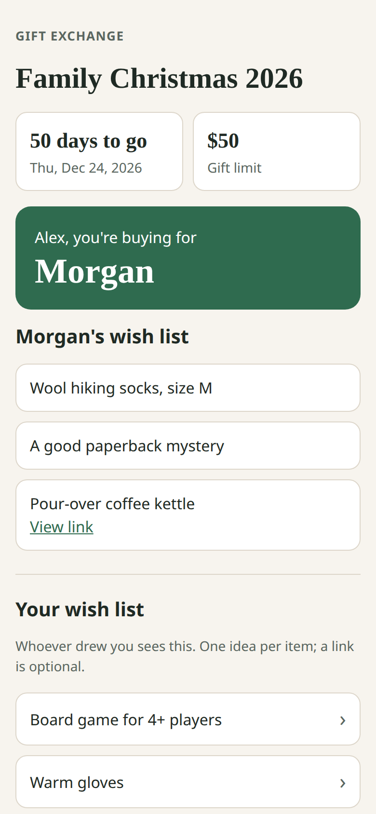
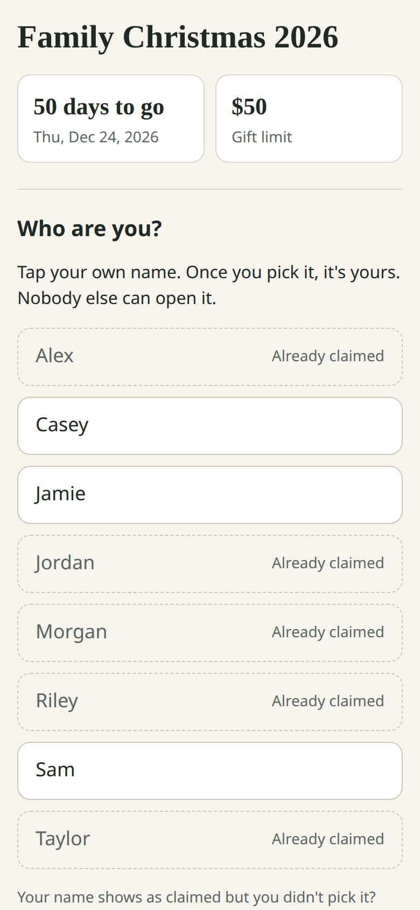
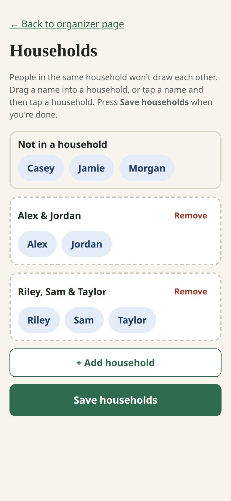
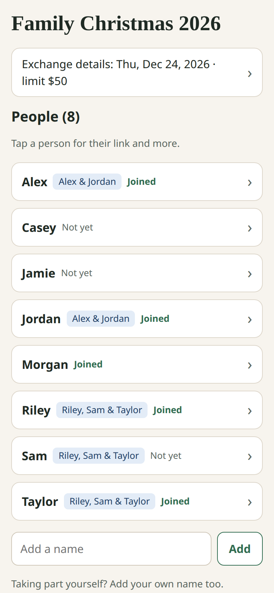
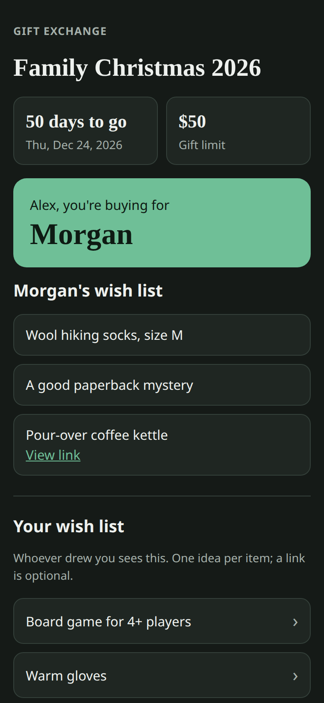

# Gift Exchange

A small, self-hostable Secret Santa web app. No accounts, no passwords, no email:
every permission is a long, unguessable link.

- The organizer creates an exchange, adds names (optionally grouped into
  households that won't draw each other), sets a date and price limit, and draws.
- One group link goes in the family chat. Each person taps their own name and
  gets a personal link showing who they're buying for and that person's wish list.
- Lost personal link? The organizer can re-send it from the organizer page.

<p>
  
  
  
</p>
<p>
  
  
</p>

Try it: <https://apps.graemecrawley.com/gift-exchange/>

## Run locally

```bash
uv venv --python 3.11 .venv
uv pip install --python .venv -r requirements-dev.txt
.venv/bin/uvicorn app.main:app --reload
.venv/bin/pytest -q
```

Configuration (environment variables):

| Variable | Default | Meaning |
|---|---|---|
| `GIFT_DB_PATH` | `./data/gift.db` | SQLite database file |
| `ROOT_PATH` | *(empty)* | URL prefix when served under a path, e.g. `/gift-exchange` |
| `PUBLIC_BASE_URL` | *(empty)* | Public address used in copied links, e.g. `https://example.com/gift-exchange` |

Exchanges are deleted automatically 60 days after their date (or a year after
creation if they have no date).

## Licence

MIT
